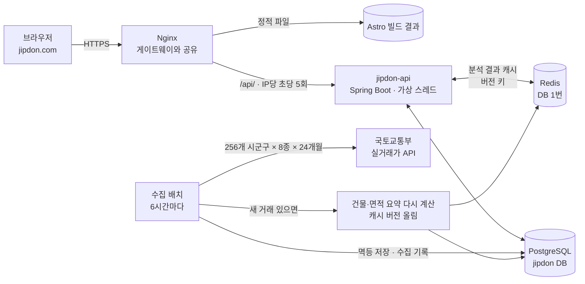

# jipdon-api

**집돈 계산기(https://jipdon.com)의 전세 위험 확인 기능을 위한 실거래가 수집·분석 서버**

국토교통부 실거래가 공공 API에서 전국 아파트·빌라·오피스텔·단독다가구의 매매·전월세 거래를 모아,
건물별·면적별 **전세가율**(최근 전세가 ÷ 최근 매매가)과 단독·다가구의 동네 시세를 계산해 돌려줍니다.
화면은 정적 사이트인 [jipdon](https://github.com/minunglee/jipdon) 저장소에 있고, 이 서버는 `https://jipdon.com/api/` 로 연결됩니다.

## 하는 일

| | |
| --- | --- |
| 수집 범위 | 전국 17개 시도 256개 시군구 × 아파트·연립다세대·오피스텔·단독다가구 매매·전월세 8종 × 최근 24개월 |
| 수집 주기 | 앱 시작 직후 + 6시간마다. 최근 3개월은 20시간마다 다시 받아 늦은 신고·계약 해제를 반영 |
| 조회 | 지역·건물 검색, 건물별 면적별 전세가율과 근거 거래 |

## 구조



## 숫자 (운영 서버 2GB, 2026-10-21)

| | |
| --- | --- |
| 데이터 | 건물 22만 4천 개, 실거래 366만 건 (수집 진행 중, 24개월 · 8종) |
| 수집 | 한 번 실행에 8,000회 호출 · 약 6분 · 실패 0건, 같은 달을 다시 받아도 중복 0 |
| 조회 p95 | 건물 분석 캐시 11ms / DB 계산 127ms, 동네 순위 9.9ms, 검색 92ms ([부하 테스트](loadtest/README.md)) |
| 자원 | 앱 힙 256MB · 컨테이너 448MB, 부하 중 329MB |
| 테스트 | 36개 (실제 API 응답 저장본 + Testcontainers PostgreSQL·Redis) |

## API

| 주소 | 설명 |
| --- | --- |
| `GET /api/regions` | 지원 지역(시군구) 목록 |
| `GET /api/buildings?region=11440&kind=APT&q=에버빌` | 지역 안에서 이름·동으로 건물 검색 (최근 24개월 거래 많은 순) |
| `GET /api/buildings/{id}/jeonse` | 면적별 매매·전세 중앙값, 전세가율, 구간(SAFE·CAUTION·WARNING·UNKNOWN), 최근 거래 5건 |
| `GET /api/detached?region=11440&type=다가구` | 단독·다가구 동별 최근 12개월 전세 보증금 사분위·중앙값, 매매 중앙값과 면적 |
| `GET /api/rankings?kind=APT&sido=서울` | 전세가율 높은 동네 순위 (동별 건물·면적 전세가율의 중앙값, 표본 3개 이상, 상위 50) |
| `GET /api/status` | 마지막 수집 시각, 대략의 건수 |
| `POST /api/assist` | AI 계산기 안내: 질문을 받아 알맞은 계산기와 미리 채운 입력값 링크. AI 호출은 같은 서버의 [AI 게이트웨이](https://github.com/minunglee/spring-llm-gateway)에 맡기고(사용량·예산 방어), 이 서버는 계산기 목록 밖의 계산기·입력칸·범위 밖 값을 버린다 |

## 설계에서 신경 쓴 점

**같은 데이터를 여러 번 받아도 결과가 같게 (멱등 수집)**
실거래가 API에는 거래 고유 번호가 없습니다. 거래 내용(지역·건물·면적·층·날짜·금액)의 해시를 고유 키로 두고
`INSERT … ON CONFLICT` 로 저장해, 같은 달을 다시 받아도 줄이 늘지 않습니다.
매매가 나중에 "계약 해제"로 바뀌어 다시 오면 해시는 같고 해제 여부만 갱신합니다.

**이어서 수집하고, 한도 안에서**
지역·종류·월 단위 수집 기록(`collect_log`)으로 할 일을 정합니다. 처음 배포 직후엔 최근 달부터 거꾸로 채워
최신 데이터가 먼저 쌓이고, 한 번에 부르는 횟수를 제한합니다. 공공데이터포털이 "하루 한도 초과"를 돌려주면
그 자리에서 멈추고 다음 실행에서 이어 갑니다. 일시적 네트워크 오류·5xx는 최대 3번 다시 시도합니다.

**전세가율 계산**
- 전용면적의 소수점을 버린 ㎡로 묶어 같은 타입끼리 비교합니다 (84.97㎡ → 84㎡형). 반올림하면 같은 59㎡형이 59.39·59.97로 신고될 때 59와 60으로 갈라집니다.
- 평균 대신 **중앙값**을 써서 급매·특이 거래 한두 건에 덜 흔들리게 합니다.
- 최근 12개월 거래로 계산하고, 없으면 24개월로 넓힌 뒤 **쓴 기간과 건수를 함께** 돌려줍니다.
- 70% 미만 여유, 70~80% 주의, 80% 이상 위험 신호로 나눕니다. 단정이 아니라 참고 지표입니다.

**단독·다가구는 건물이 아니라 동 단위로**
단독·다가구 실거래 자료는 개인정보 보호로 지번이 가려져(`*`, `1*`) 오고 건물 이름이 없으며, 전월세에는 지번이 아예 없습니다.
건물을 특정할 수 없고 다가구는 매매(건물 전체)와 전세(방 하나)의 단위도 달라 전세가율이 의미가 없습니다.
그래서 따로 저장(`detached_deal`)해 동별 전세 보증금 범위(25~75%)와 매매가를 PostgreSQL `percentile_cont`로 계산합니다.

**지역 코드는 실제 API로 검증**
2026년 행정구역 개편으로 인천(제물포·영종·서·검단구), 화성시(4개 구), 광주·전남 통합(29xxx·46xxx → 12xxx) 코드가 바뀌었고,
예전 코드로는 과거 거래까지 0건이 나옵니다. 후보 코드를 API에 조회해 거래가 나오는 코드를 찾고 응답의 동 이름으로 지역을 확인했습니다.
목록은 `src/main/resources/regions.tsv` 에 있습니다.

**동네 순위는 미리 요약해 둔 표로**
수백만 건을 요청마다 훑지 않도록, 수집이 끝나면 건물·면적별 최근 12개월 매매·전세 중앙값과 전세가율을 `area_ratio` 표에 다시 계산합니다
(운영 데이터 5만여 건물·면적 약 1.4초). 순위는 이 표를 동 단위로 묶어 중앙값으로 매기고, 표본 3개 미만인 동과
전세가율 20% 미만·150% 초과(지분 거래·공공임대 등 이상값)는 뺍니다.

**캐시 무효화**
분석 결과는 Redis에 24시간 캐시합니다. 키에 버전 번호를 넣어 두고, 새 거래가 들어오면 버전만 올려
예전 캐시를 한 번에 버립니다(키를 찾아 지우지 않음). Redis를 쓸 수 없으면 캐시 없이 계산합니다.

**서버 한 대 공유**
게이트웨이와 같은 2GB 서버에서 PostgreSQL·Redis·Nginx를 함께 씁니다.
DB와 계정은 따로(`jipdon`), Redis는 다른 DB 번호(1)를 쓰고, 앱은 힙 256MB·컨테이너 448MB로 제한합니다.

## 기술

Java 21 · Spring Boot 4.1 (가상 스레드) · JdbcTemplate 일괄 저장 · PostgreSQL 16 · Flyway · Redis · Testcontainers · Docker · GitHub Actions

## 로컬 실행

```bash
cp .env.example .env   # 공공데이터포털 일반 인증키 입력 (인코딩·디코딩 어느 쪽이든 됨)
./gradlew bootRun      # compose.yaml의 PostgreSQL·Redis가 자동으로 뜬다. 수집은 기본으로 꺼져 있음
JIPDON_COLLECT_ENABLED=true ./gradlew bootRun   # 수집까지 켜기
./gradlew test         # 공공 API를 부르지 않고 저장해 둔 실제 응답으로 검증
```

## 데이터 출처

국토교통부 실거래가 정보 (공공데이터포털 data.go.kr). 계산 결과는 참고용이며 실제 계약 전에는 등기부등본의 선순위 권리 등을 반드시 확인해야 합니다.
